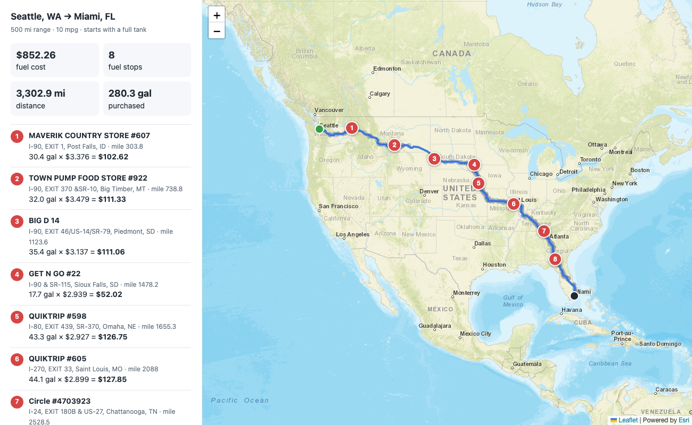

# Fuel Route Planner

A Django 6.1 API that takes a start and finish location in the USA and returns:

- the driving route (GeoJSON, plus an interactive map page),
- where to fuel up along the way to keep fuel cost low, given a 500-mile range,
- the total amount spent on fuel at 10 miles per gallon.

Each request makes **one** routing API call, or none if the route is cached. `City, ST` locations are geocoded offline, so they need no API call either. A request with a cached route returns in about 20–50 ms, and a new coast-to-coast trip takes about 1–2 s, almost all of it the OSRM call.



## Quick start

```bash
python3.13 -m venv .venv && source .venv/bin/activate   # Python 3.12+
pip install -r requirements.txt
python manage.py migrate
python manage.py load_fuel_stations    # loads data/fuel-prices.csv (offline, <1 s)
python manage.py runserver
```

```bash
curl "http://127.0.0.1:8000/api/route/?start=New%20York,%20NY&finish=Los%20Angeles,%20CA"
```

Then open the `map_url` from the response in a browser. You don't need an API key or a `.env` file.

**Postman:** import `postman/fuel-route.postman_collection.json`. Every planning request has tests, and its **Visualize** tab draws the route and fuel stops on a map.

## API

### `GET /api/route/?start=…&finish=…` or `POST /api/route/` with a JSON body

| field          | required | description |
|----------------|----------|-------------|
| `start`        | yes      | `"City, ST"`, `"City, State"`, a street address, or `"lat,lon"` (must be in the USA) |
| `finish`       | yes      | same formats |
| `stop_penalty` | no       | Dollar cost the optimizer assigns to each stop. Default `5`. `0` gives the cheapest fuel no matter how many stops it takes (see [Optimization](#optimization)). |

Example response (Houston, TX → Denver, CO; route coordinates trimmed):

```json
{
  "start":  {"lat": 29.785743, "lon": -95.388806, "label": "Houston, TX", "source": "gazetteer"},
  "finish": {"lat": 39.76185, "lon": -104.881105, "label": "Denver, CO", "source": "gazetteer"},
  "summary": {
    "total_distance_miles": 1015.3,
    "estimated_drive_time_hours": 18.6,
    "total_fuel_cost": 140.03,
    "total_gallons_purchased": 51.5,
    "fuel_used_gallons": 101.53,
    "average_price_per_gallon": 2.719,
    "number_of_fuel_stops": 2,
    "stations_considered": 131
  },
  "fuel_stops": [
    {
      "stop_number": 1, "station_id": 66341, "name": "7-ELEVEN #218",
      "address": "I-44, EXIT 4", "city": "Harrold", "state": "TX",
      "lat": 34.06757, "lon": -99.033091,
      "price_per_gallon": 2.687, "route_mile": 412.3, "miles_off_route": 0.9,
      "fuel_on_arrival_gallons": 8.8, "gallons_purchased": 41.2, "cost": 110.72
    },
    {
      "stop_number": 2, "station_id": 72816, "name": "QUIKTRIP #7914",
      "address": "I-27 EXIT 117", "city": "Amarillo", "state": "TX",
      "lat": 35.198064, "lon": -101.833107,
      "price_per_gallon": 2.846, "route_mile": 604.7, "miles_off_route": 4.7,
      "fuel_on_arrival_gallons": 30.7, "gallons_purchased": 10.3, "cost": 29.31
    }
  ],
  "assumptions": {
    "vehicle_range_miles": 500, "miles_per_gallon": 10, "tank_capacity_gallons": 50.0,
    "starts_with_full_tank": true, "stop_penalty_usd": 5.0, "station_corridor_miles": 10.0
  },
  "route": {
    "type": "Feature",
    "properties": {"source": "OSRM", "simplified_points": 577},
    "geometry": {"type": "LineString", "coordinates": [[-95.38881, 29.78576], "..."]}
  },
  "external_api_calls": {"geocoding": 0, "routing": 1},
  "map_url": "http://127.0.0.1:8000/api/route/map/?start=Houston%2C+TX&finish=Denver%2C+CO",
  "response_time_ms": 1052
}
```

`total_fuel_cost` is the sum of the `cost` of each stop. `route` is a GeoJSON Feature, so you can paste it straight into geojson.io.

| status | when |
|--------|------|
| 400 | missing or invalid field; location not found or outside the USA |
| 422 | no drivable route, or a stretch longer than 500 miles with no station on it |
| 502 | the routing or geocoding service failed |
| 503 | fuel stations not loaded yet (run `load_fuel_stations`) |

### `GET /api/route/map/?start=…&finish=…`

An HTML page that draws the route with Leaflet on Esri street-map tiles, showing the numbered fuel stops, every candidate station along the corridor, and a cost breakdown. It reads the cached route, so opening it right after the API call costs no extra API calls.

## How it works

```
start, finish ──► geocode ──► OSRM route ──► stations near the route ──► optimizer ──► JSON / map
                 (offline)    (1 API call,   (KD-tree, in memory)        (DP over
                              cached)                                     fuel levels)
```

1. **Geocoding** (`services/geocoding.py`). The fuel CSV has no coordinates, only an exit-style address plus a city and state. Every station and every `"City, ST"` input is resolved offline against the US Census 2024 gazetteer (`data/us_places.csv`). City names are normalized so that `St.`/`Saint`, `Mc Calla`/`McCalla` and `Nashville`/`Nashville-Davidson` all match. The 134 station towns missing from the gazetteer, mostly unincorporated places like Breezewood, PA, were looked up once through Nominatim and committed in `data/geocode_overrides.csv`. Only free-text addresses call Nominatim at request time, and each result is cached.
2. **Routing** (`services/routing.py`). One call to the free, keyless [OSRM](https://project-osrm.org) public server returns the full-resolution route geometry. The result is cached by coordinates.
3. **Stations along the route** (`services/stations.py`). All 6,626 US stations are held in numpy arrays. The route is densified to vertices at most 0.5 mi apart and put into a `scipy` KD-tree. One vectorized query then finds, for every station within 10 miles of the road, its mile marker and its distance from the road. This takes a few milliseconds even for a coast-to-coast trip.
4. **Optimization** (`services/optimizer.py`), described below.

### Optimization

The plan minimizes `fuel cost + stop_penalty × number_of_stops`, using a dynamic program over the stations in route order. The state is the cost of having each possible fuel level, from 0 to 500 miles of range in 1-mile steps. At each station:

- **driving** to the station shifts that vector down by the length of the leg;
- **buying** any amount is `min over g ≤ f of (cost[g] + (f − g) × price) + penalty`, which is a prefix minimum, so each station takes a few vectorized numpy operations.

The total work is O(stations × 500), about 4 ms for NYC → LA. Backtracking through the stored choices gives the stops and the gallons bought at each.

**Why a stop penalty?** The pure price optimum (`stop_penalty=0`) is a known greedy: if a cheaper station is within range, buy just enough to reach it; otherwise fill up. That greedy makes **17 stops** on NYC → LA, some for a gallon or two, to save cents. With the default $5 per stop, the planner makes **6 stops** and spends **$705.51** instead of **$698.47**. The extra $7 buys 11 fewer stops, which roughly reflects the time a real stop costs. Every purchase on that trip is then at least 18 gallons. The tests check the DP with `stop_penalty=0` against an independent implementation of that greedy on 200 random instances.

### Assumptions

- The vehicle **starts with a full tank** (500 miles of range) and the plan ends with an empty one. Fuel already in the tank is not counted as money spent. A trip under 500 miles therefore needs no stops and costs $0, although `fuel_used_gallons` still reports the fuel burned.
- Station coordinates are city centroids, because the CSV gives only an exit, a city and a state. Stations within **10 miles** of the route count as on the route, and the detour to reach them is not charged.
- A truck stop appears once per supplier rack in the CSV, so the 678 duplicate IDs are reduced to their **lowest** price. Canadian rows (620) are excluded because the trip is within the USA.
- The OSRM and Nominatim public servers are meant for light use. For production, set `OSRM_BASE_URL` and `NOMINATIM_BASE_URL` to self-hosted instances.

## Project layout

```
config/                     settings, urls, wsgi (builds the in-memory indexes at startup)
fuel_route/
  models.py                 FuelStation
  views.py, serializers.py  DRF endpoint and map view
  services/
    geocoding.py            lat,lon / gazetteer / Nominatim
    routing.py              OSRM client and caching
    stations.py             in-memory station index and KD-tree corridor search
    optimizer.py            DP refueling plan
    planner.py              orchestration and response shape
    geometry.py             polyline decoding, haversine, densify, simplify
  management/commands/
    load_fuel_stations.py   CSV → DB (offline)
    build_geodata.py        one-time rebuild of data/us_places.csv and data/geocode_overrides.csv
  templates/fuel_route/map.html
  tests/                    optimizer, geometry, geocoding and API tests (OSRM mocked)
data/                       fuel price CSV, gazetteer, geocode overrides
postman/                    Postman collection with map visualizer
```

## Tests

```bash
python manage.py test
```

The tests run offline. OSRM and Nominatim are mocked, and the API tests use a synthetic route.

## Configuration

These environment variables are optional:

| variable | default |
|----------|---------|
| `DJANGO_SECRET_KEY` | development key |
| `DJANGO_DEBUG` | `1` |
| `DJANGO_ALLOWED_HOSTS` | `localhost,127.0.0.1` |
| `OSRM_BASE_URL` | `https://router.project-osrm.org` |
| `NOMINATIM_BASE_URL` | `https://nominatim.openstreetmap.org` |
| `STATION_CORRIDOR_MILES` | `10` |
| `EXTERNAL_API_TIMEOUT` | `15` seconds |
